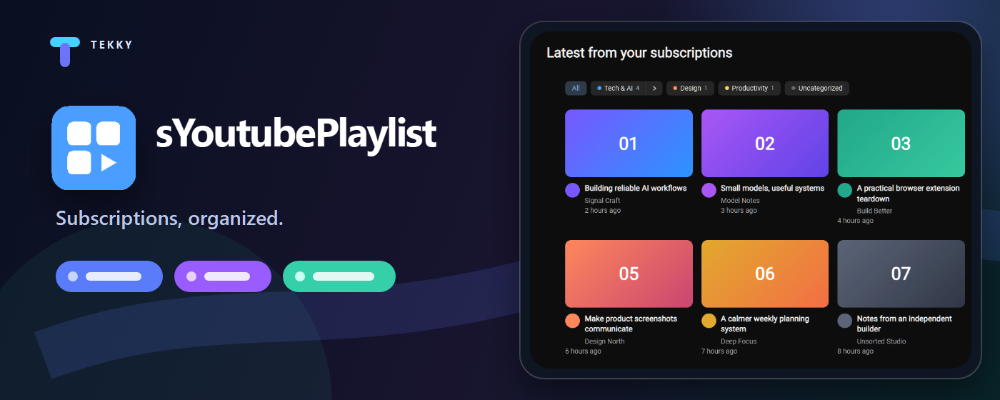
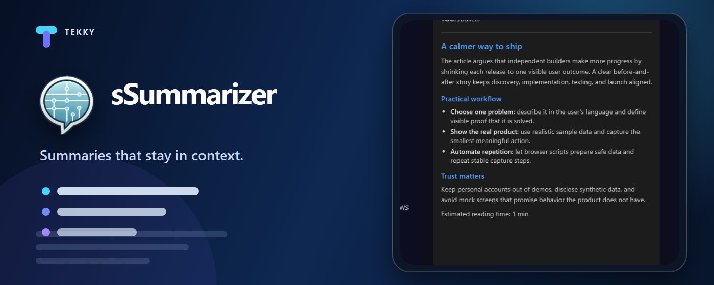

  

Useful browser extensions built and collected by Tekky.

## Featured extensions

## 📂 Repository Directory

| Folder | Type | Description |
| :--- | :--- | :--- |
| [**sBookmarkCleaner**](./sBookmarkCleaner) | Extension | Bookmark management utility |
| [**sExport**](./sExport) | Extension | Data export tool |
| [**sGesture**](./sGesture) | Extension | Mouse gesture navigation |
| [**sNeatBookmarks**](./sNeatBookmarks) | Extension | Bookmark organizer |
| [**sRedditHighlighter**](./sRedditHighlighter) | Extension | Highlights new Reddit comments since your last visit |
| [**sSummarizer**](./sSummarizer) | Extension | Content summarization tool |
| [**sTabControl**](./sTabControl) | Extension | Tab management utility |
| [**sUndoClose**](./sUndoClose) | Extension | Undo closed tabs helper |
| [**sYoutubePlaylist**](./sYoutubeOrganizer) | Extension | YouTube subscription playlist organizer |
